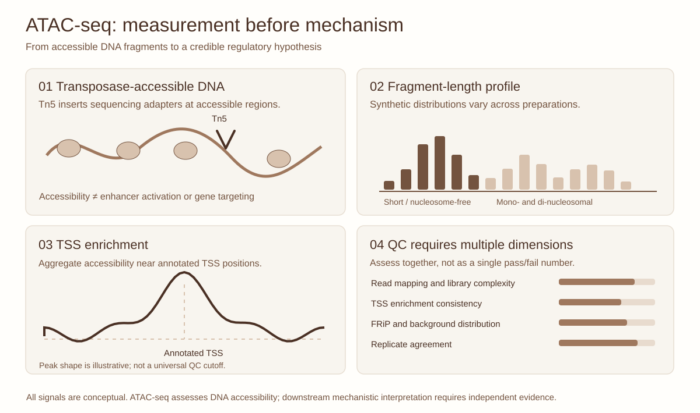

::: {.lesson-meta}
Experimental epigenomicsIntermediate75 minutesSynthetic illustration
:::

## An attractive accessibility track is not necessarily a successful assay

You have sequenced three colorectal cancer organoid preparations. One produces many peaks but poor reproducibility; one exhibits clear transcription-start-site (TSS) enrichment but fewer reads; and the last has a high fraction of mitochondrial alignments. **Which would you advance?** No single QC statistic settles this question.

ATAC-seq uses a hyperactive Tn5 transposase to integrate sequencing adapters preferentially into accessible chromatin. It produces a population-level measure of transposase accessibility, not a direct measurement of enhancer activity, transcription-factor occupancy or regulatory causality.

{fig-alt="Four-panel synthetic ATAC-seq schematic showing accessible chromatin tagged by Tn5, a fragment-size profile, an aggregate transcription-start-site enrichment curve, and complementary library QC metrics."}

*Figure 1. Original editorial schematic; fragment frequencies, TSS curve and bars are invented, not benchmark thresholds.*

## 1. Read the physical measurement

A transcription-factor footprint, a nucleosome-free fragment profile and a promoter-associated ATAC signal are interpreted from sequencing fragments. Their appearance depends on library composition, insertion bias, alignment, depth and how reads were filtered. Accessibility differences can reflect tumour-cell identity, cell composition, copy number or technical variation.

## 2. QC dimensions worth measuring together

| Dimension | What to inspect | Interpretation limit |
|---|---|---|
| Library complexity | Duplicates and informative fragments | A complexity score alone does not certify regulatory validity |
| Fragment-size spectrum | Short versus nucleosomal-length populations | A single expected pattern does not fit every protocol and sample |
| TSS enrichment | Aggregate coverage near appropriately annotated TSS | Depends on genome annotations and pipeline |
| FRiP | Fraction of fragments in a **defined** peak set | Caller-dependent; can reward overbroad peaks |
| Mapping / mitochondrial signal | Unique mapping, organellar fraction and filtering | Protocol, sample type and conditions matter |
| Replicates and controls | Concordance across independent biological samples | Technical duplication is not biological replication |

## 3. Practical: challenge an apparently good library

Imagine three **synthetic** sample summaries:

| Sample | TSS enrichment | FRiP | Duplicate fraction | Replicate concordance |
|---|---:|---:|---:|---|
| PDO-A | 9 | 0.30 | 0.21 | High |
| PDO-B | 15 | 0.17 | 0.58 | Low |
| PDO-C | 6 | 0.39 | 0.25 | High |

The values are invented and **must not be used as universal QC cutoffs**. Propose a ranked follow-up plan and explain why high TSS enrichment cannot rescue evidence of severe duplication and discordance. Distinguish technical reruns from independent organoid replicates.

## 4. Integrating ATAC with the correct evidence

A gain in accessibility near a cancer-associated gene is a hypothesis-generating observation. H3K27ac and expression may provide convergent context, while perturbing a candidate element can test function. Read the [enhancer evidence case](enhancer-to-organoid.qmd), try [loading a BED/bedGraph genomic track](gosling-genome-tracks.qmd), and revisit [peak-caller interpretation](cutrun-benchmarking.qmd).

## Discussion questions

1. What makes FRiP incomparable when callers or peak-width criteria change?
2. How could copy-number amplification create an apparent tumour-specific accessibility signal?
3. Which analyses would test for batch-associated differences separately from biological cell states?

## References

- Buenrostro JD et al. Transposition of native chromatin for fast and sensitive epigenomic profiling of open chromatin, DNA-binding proteins and nucleosome position. *Nature Methods* (2013). [doi:10.1038/nmeth.2688](https://doi.org/10.1038/nmeth.2688).
- Corces MR et al. An improved ATAC-seq protocol reduces background and enables interrogation of frozen tissues. *Nature Methods* (2017). [doi:10.1038/nmeth.4396](https://doi.org/10.1038/nmeth.4396).
- ENCODE Project Consortium. Expanded encyclopaedias of DNA elements in the human and mouse genomes. *Nature* (2020). [doi:10.1038/s41586-020-2493-4](https://doi.org/10.1038/s41586-020-2493-4).
