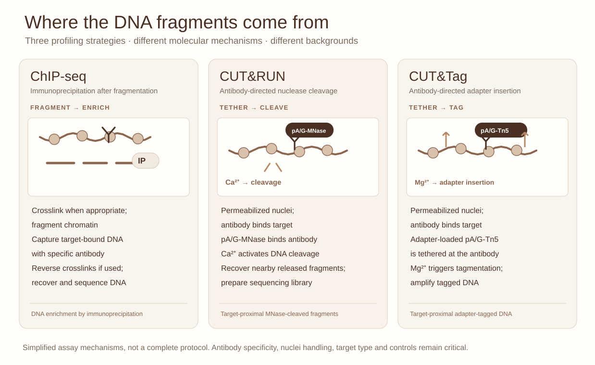

::: {.lesson-meta}
Experimental genomicsIntermediate / advanced75–90 minutes
:::

## Three methods, three sets of assumptions

You want to profile H3K27ac in a limited colorectal organoid specimen. Another project requires mapping a transcription factor. Should the same technique, control and caller strategy be used for both?

{fig-alt="Three panels compare ChIP-seq immunoprecipitation after fragmentation, antibody-tethered CUT&RUN MNase cleavage activated by calcium, and antibody-tethered CUT&Tag Tn5 adapter insertion activated by magnesium."}

*Figure 1. Revised mechanistic schematic—not a laboratory protocol. CUT&RUN generally involves antibody-bound target chromatin, tethering of pA/G-MNase and **Ca²⁺-activated cleavage**, followed by recovery of target-proximal fragments. CUT&Tag uses antibody-tethered, adapter-loaded pA/G-Tn5 and **Mg²⁺-activated tagmentation**. ChIP-seq uses fragmentation followed by target-specific immunoprecipitation. Performance depends on target, sample, controls and implementation.*

[Open the full-resolution assay mechanism figure ↗](../assets/cutrun-cuttag-chip.svg){target="_blank"}

## 1. What is enriched?

**ChIP-seq** enriches target-associated DNA by immunoprecipitation after chromatin fragmentation. Crosslinking is common for many applications but not universal.

**CUT&RUN** typically uses antibody-guided, Ca²⁺-activated micrococcal nuclease cleavage to recover DNA close to chromatin-associated targets. Recovery and digestion conditions can strongly influence the fragment distribution and background.

**CUT&Tag** tethers an adapter-loaded transposase (commonly pA/G-Tn5) through an antibody; Mg²⁺ activation inserts adapters near the target, facilitating subsequent amplification and sequencing. Integration and amplification biases require careful controls.

Neither CUT&RUN nor CUT&Tag simply eliminates all technical bias. The measurement chemistry changes what background, replicates and fragment-size profiles mean.

## 2. Evaluate the design, not the method's reputation

| Decision | What you need to justify |
|---|---|
| TF versus broad histone mark | Is the genomic signal expected to be sharp or broad? |
| Low input and organoids | Is the chosen protocol validated at that input and condition? |
| Antibody | What specificity evidence and controls are available? |
| Spike-in or reference | What does it correct, and what assumptions does it introduce? |
| Replicates | Are samples independent, and are treatments randomized across batches? |
| Peak caller | Does its background model fit the chosen assay and target? |

## 3. A laboratory meeting challenge

You receive two synthetic H3K27ac profiles. One produces 21,000 small peaks and the other 11,000 broad peaks. **Neither count establishes which method or caller is more faithful**. Describe how you would compare reproducibility, local enrichment, width sensitivity and orthogonal evidence. Connect this discussion to our [CUT&RUN peak-caller practical](cutrun-benchmarking.qmd), including the published methodological benchmark.

## 4. Design a reproducible validation study

Propose a two-assay experiment with a pre-specified primary outcome, independent biological replicates, matched input/antibody QC, data-processing parameters and an assessment of genome-wide versus selected-locus concordance. A reproducible peak is still an observation, not a target-gene assignment.

For track inspection, use the [genomic visualization studio](gosling-genome-tracks.qmd) and compare the implications of signal files with interval calls.

### Primary mechanistic distinction

The diagrams illustrate representative workflows, not all methodological variants. Antibody-guided localization, cleavage or tagmentation, differential recovery and library preparation are separate potential sources of bias; none alone provides a universal ranking of assay sensitivity or specificity.

## References

- Johnson DS et al. Genome-wide mapping of in vivo protein-DNA interactions. *Science* (2007). [doi:10.1126/science.1141319](https://doi.org/10.1126/science.1141319).
- Skene PJ, Henikoff JG, Henikoff S. Targeted in situ genome-wide profiling with high efficiency for low cell numbers. *Nature Protocols* (2018). [doi:10.1038/nprot.2018.015](https://doi.org/10.1038/nprot.2018.015).
- Kaya-Okur HS et al. CUT&Tag for efficient epigenomic profiling of small samples and single cells. *Nature Communications* (2019). [doi:10.1038/s41467-019-09982-5](https://doi.org/10.1038/s41467-019-09982-5).
- Nooranikhojasteh A, Tavallaee G, Orouji E. Benchmarking peak calling methods for CUT&RUN. *Bioinformatics* (2025). [doi:10.1093/bioinformatics/btaf375](https://doi.org/10.1093/bioinformatics/btaf375).
