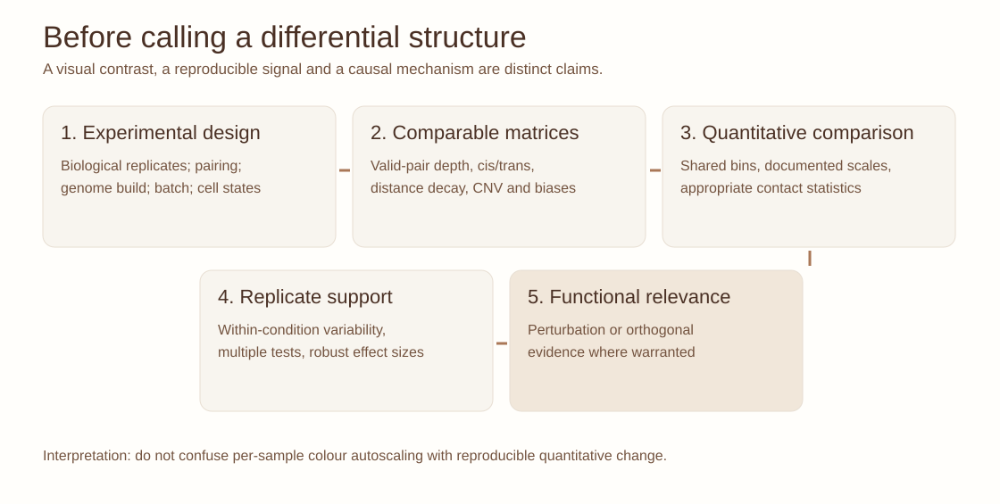

::: {.lesson-meta}
Advanced 3D genomics90–120 minutesSynthetic exerciseReplicates and normalization
:::

## Two beautiful maps can tell a misleading story

Suppose you compare a colorectal tumour organoid and a matched normal model. One heatmap appears brighter around an oncogene; the other appears to have a sharper domain boundary. **Before asking what changed biologically, ask whether the maps are comparable.** Differences in valid-pair counts, library complexity, mappability, copy number, genomic distance decay, bin size and matrix processing can all alter apparent structure.

The key distinction is between **visual change**, **reproducible contact-frequency difference**, **statistically supported structural change**, and **demonstrated functional consequence**. These are four different claims.

{fig-alt="Five readable cards: study design, comparable matrices, quantitative comparison, replicate support and functional relevance."}

*Figure 1. Original vector workflow for responsible multi-sample Hi-C comparison; this is methodological guidance, not a HiC-ECC result.*

## 1. Define the comparison before opening the heatmaps

| Design | Question | Essential caution |
|---|---|---|
| A vs B, one sample each | Where are candidate differences? | No biological replication: descriptive exploration only |
| A vs B, several biological replicates | Are changes reproducible within and across groups? | Account for within-group variability and technical confounders |
| Multiple tissues or organoid states | Which patterns are shared, state-specific or continuous? | Sample composition, batch, sequencing depth and non-independence |
| Longitudinal or paired samples | What changes within a matched biological unit? | Preserve pairing in the statistical model |

A replicate is an **independently prepared biological sample**, not a second computational subsample of the same Hi-C library.

## 2. A disciplined analysis workflow

1. **Check design and provenance:** genome assembly, restriction or fragmentation strategy, read length, sample identity, biological replication and experimental batch.
2. **Evaluate sample-level QC:** uniquely mapped and valid pairs, duplicate rates, cis/trans ratios, distance decay, coverage and other assay-specific metrics. A single QC statistic is never sufficient.
3. **Establish comparable bins and filters:** use the same reference assembly and genomic binning; handle blacklisted or low-mappability regions consistently.
4. **Choose and document normalization:** matrix balancing, distance-dependent expected counts and joint/cross-sample normalization answer different questions. Do not compare raw colour scales and call the result differential contact.
5. **Check reproducibility:** biological replicate agreement, within-condition variability and sensitivity to depth or filtering.
6. **Test appropriate features:** contacts, loops, boundaries, domain insulation, compartments or larger-scale matrix structure require different statistical hypotheses and multiple-testing strategies.
7. **Validate biological interpretations:** use chromatin accessibility, transcription, chromatin marks, structural-variant assessment and perturbation as appropriate.

## 3. An original synthetic exercise: three conditions

Imagine a simulated 400-kb region binned at 20 kb with three conditions: baseline A, perturbation B and recovery C. In B, a programmed focal contact enrichment increases while the average local distance-decay trend remains broadly similar. In C, the programmed enrichment partly returns toward A. You are given **three technical drawings**, not experimental replicates.

| Synthetic comparison | Baseline A | Perturbation B | Recovery C |
|---|---:|---:|---:|
| Focal contact count (illustrative) | 24 | 57 | 31 |
| Mean contacts at comparable genomic separation (illustrative) | 20 | 38 | 23 |
| Focal O/E (illustrative) | 1.20 | 1.50 | 1.35 |

**Exercise:** Compute each O/E ratio and explain why a rise from 1.20 to 1.50 does *not* establish a statistically significant loop gain. How might changes in distance decay, copy number, biological variation or normalization alter the interpretation? What biological replicates and controls would be required?

*These numbers are entirely invented and deliberately small; they are not HiC-ECC outputs, sequencing recommendations or patient observations.*

## Interactive laboratory: three samples, two synthetic replicates each

Explore three **invented sample conditions** (A, perturbed B, recovery C) and two simulated matrices per condition. First use a shared scale, then independent autoscaling. Try raw counts and distance-related O/E. Finally introduce an intentionally discordant B replicate. The viewer shows an **average** per condition; no independent biological experiment or statistical significance is represented.

<iframe src="../interactives/hic-sample-compare.html" title="Interactive synthetic Hi-C comparison: A B C, scaling, distance normalization and replicate concordance" class="learning-iframe learning-iframe--compare" loading="lazy"></iframe>

*Interactive 2. Original, fully synthetic contact matrices. The displayed difference is relative to A after a simplified distance-normalization step; it is not a differential loop-caller output or validated effect size.*

**Interpretation prompt:** Which sample comparison survives a change of colour scale, and which change disappears when a replicate is discordant? A condition-level average can hide meaningful within-group heterogeneity. [Review the terminology](hic-glossary.qmd) before interpreting the result.

## 4. What exactly can change?

**Differential contacts** ask whether specified bin pairs have different contact intensities under a suitable model.

**Differential domain organization** asks whether insulation, boundaries or intra-domain interaction patterns differ; a domain caller can report a shifted boundary even when the underlying maps are broadly similar.

**Differential compartments** concern the distribution of long-range contact preference; align eigenvector signs and inspect compartment-associated annotations before calling a switch.

**Whole-map or region-level comparison** asks whether a broader interaction pattern differs without first reducing it to a list of peaks or boundaries. The choice of scale, similarity metric, statistical calibration and reproducibility criteria matters.

The distinction is crucial: an algorithm can detect a pattern that is **specific to the compared samples** without establishing that it is a causal or clinically meaningful feature.

## 5. Connection to HiC-ECC: an emerging framework

The OroujiLab **HiC-ECC** research programme addresses sample-specific chromatin interaction patterns in 3D-genome data. The associated methods manuscript is under journal review, so this lesson intentionally **does not describe unpublished performance claims, benchmarks, implementation details or study-specific results**. Once a citable public version is available, the lesson can be extended with a reproducible tutorial and exact software version.

In the meantime, this exercise teaches general principles of differential Hi-C analysis that stand independently of any particular unpublished method.

## 6. Seminar challenge

A collaborator reports a “new TAD” in a tumour-derived organoid relative to normal. They provide one heatmap per condition, each automatically rescaled to its own colour range.

Write a short review that requests the **five most important pieces of evidence** before accepting the claim. Distinguish an apparent visual difference from a change in domain insulation, and explain how copy-number changes or heterogeneous cell populations might affect the result.

## Continue learning

The [five structural signatures](hic-structures.qmd) explain the features being compared. [What survives when you change Hi-C resolution?](hic-resolution-lab.qmd) tests binning and depth. The [assay-family guide](hic-assays.qmd) helps decide whether targeted, genome-wide or ligation-free approaches best fit the comparison.

## Further reading

- Tavallaee G, Orouji E. Mapping the 3D genome architecture. *Computational and Structural Biotechnology Journal* **27**, 89–101 (2025; online 2024). [doi:10.1016/j.csbj.2024.12.018](https://doi.org/10.1016/j.csbj.2024.12.018).
- Forcato M et al. Comparison of computational methods for Hi-C data analysis. *Nature Methods* (2017). [doi:10.1038/nmeth.4325](https://doi.org/10.1038/nmeth.4325).
- Rao SSP et al. A 3D map of the human genome at kilobase resolution reveals principles of chromatin looping. *Cell* (2014). [doi:10.1016/j.cell.2014.11.021](https://doi.org/10.1016/j.cell.2014.11.021).
