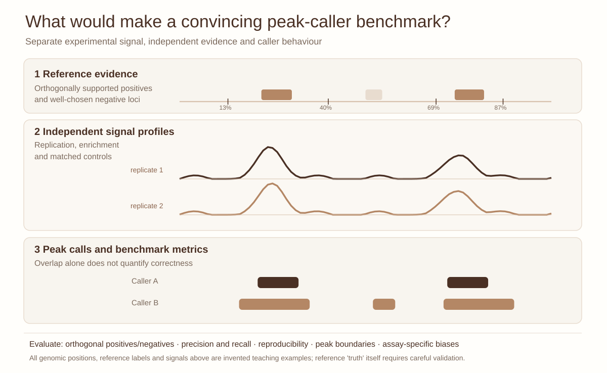

::: {.lesson-meta}
<span class="pill">Intermediate</span><span class="pill">60–90 minutes</span><span class="pill">BED · Python</span><span class="pill">Synthetic intervals</span>
:::

## A peak is an inference, not a molecular photograph

Imagine two groups receiving identical CUT&RUN sequencing reads for H3K27ac. One reports twice as many peaks, the other far fewer. Which analysis is more accurate? **Neither number alone answers the question.** The distinction between signal detection and biological specificity is the central theme of this lesson.

CUT&RUN profiles chromatin-associated targets using antibody-tethered nuclease cleavage. The resulting fragment distribution and background can differ from conventional ChIP-seq, motivating specialized peak callers such as SEACR. Moreover, a histone modification with broad domains and a sharply localized transcription factor need not obey the same peak model.

### Learning objectives

By the end, you should be able to identify the assumptions in peak calling; distinguish interval overlap, enrichment and reproducibility; run a simple BED comparison; and propose a defensible benchmark suitable for a given target and experimental design.

## 1. What would constitute a convincing benchmark?

{fig-alt="Original vector CUT&RUN caller benchmark with two synthetic reference regions, two simulated signal replicates and intervals from Caller A and Caller B. Precision, recall and reproducibility require independent validation."}

*Figure 1. Synthetic benchmark design. The top annotation is a **hypothetical reference**, not known experimental ground truth. Two callers can disagree on widths and backgrounds; agreement between callers is not proof of accuracy.*

[Open the full-resolution peak-caller benchmark ↗](../assets/peak-caller.svg){target="_blank"}

Before examining the output, propose measurements in these categories:

| Dimension | Observable evidence | What it does not prove |
|---|---|---|
| Raw experiment | Fragment and mapping metrics, antibody controls | That every interval is specific |
| Peak properties | Number, width, genomic coverage, local enrichment | More detected intervals means more true sites |
| Replicate behavior | Reproducible signal and called regions | Consensus equals truth |
| Genomic context | Promoter or enhancer annotation, known loci | A particular gene is regulated |
| Orthogonal evidence | Independent profiling or perturbation | All targets and cell types behave alike |

The *appropriate* metric depends on the biological target, depth, replicate structure and downstream goal.

## 2. A small, runnable disagreement

Download the deliberately **synthetic** [caller A BED](../exercises/cutrun-peak-calling/peaks_A.bed), [caller B BED](../exercises/cutrun-peak-calling/peaks_B.bed) and [comparison script](../exercises/cutrun-peak-calling/compare_peaks.py).

```bash
python3 exercises/cutrun-peak-calling/compare_peaks.py \
  exercises/cutrun-peak-calling/peaks_A.bed \
  exercises/cutrun-peak-calling/peaks_B.bed
```

The script merges overlapping intervals, computes set coverage in base pairs and reports base-pair Jaccard similarity. It does not estimate sensitivity or false-discovery rate.

**Pause and reason:** If one caller systematically outputs wider peaks, could its base-pair overlap improve even if the boundaries become less accurate? How might this differ for H3K4me3, H3K27ac and H3K27me3?

## 3. From a toy example to a research-grade study

A convincing analysis uses biological replicates, appropriate controls, stratification by histone mark, replicate consistency and orthogonal evidence, and examines whether conclusions depend on a particular metric or parameterization.

A pertinent case is **Nooranikhojasteh A, Tavallaee G & Orouji E (2025), _Benchmarking peak calling methods for CUT&RUN_**, [Bioinformatics](https://doi.org/10.1093/bioinformatics/btaf375). Read its methods and answer:

1. Which histone modifications and biological sources were profiled?
2. What evidence is used to judge performance beyond peak counts?
3. Are conclusions target-specific or assumed to generalize universally?
4. How would you stress-test the findings under lower depth or an alternate control strategy?

For teaching, consider exploring the [public paper's archived software](https://doi.org/10.5281/zenodo.15208150) or associated [GEO study GSE282809](https://www.ncbi.nlm.nih.gov/geo/query/acc.cgi?acc=GSE282809), but keep original license and data provenance.

## 4. Interpretation challenge

Two callers have modest Jaccard overlap, yet both reproduce the same promoter-associated regions across biological replicates. Write (a) a descriptive results sentence that makes no accuracy claim, (b) two explanations for the disagreement, and (c) an additional experiment or analysis that could distinguish them.

**Instructor note:** Avoid a leaderboard mentality. Even a high peak-level overlap does not identify the best method without independent evidence and a defined decision problem.

## References

- Skene PJ, Henikoff JG, Henikoff S. *Targeted in situ genome-wide profiling with high efficiency for low cell numbers*. Nature Protocols (2018). [doi:10.1038/nprot.2018.015](https://doi.org/10.1038/nprot.2018.015).
- Meers MP, Tenenbaum D, Henikoff S. *Peak calling by Sparse Enrichment Analysis for CUT&RUN chromatin profiling*. Epigenetics & Chromatin (2019). [doi:10.1186/s13072-019-0287-4](https://doi.org/10.1186/s13072-019-0287-4).
- Nooranikhojasteh A, Tavallaee G, Orouji E. *Benchmarking peak calling methods for CUT&RUN*. Bioinformatics (2025). [doi:10.1093/bioinformatics/btaf375](https://doi.org/10.1093/bioinformatics/btaf375).

*All example peak intervals and the illustration are synthetic. The study cited above is real and appropriately attributed.*
