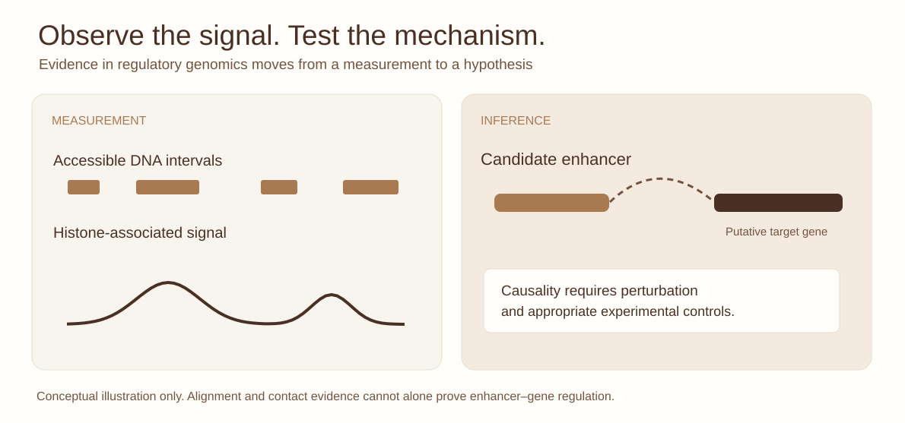

::: {.lesson-meta}
Advanced75–90 minutesInteractive exerciseSynthetic case
:::

## An accessible enhancer does not identify its target gene

Suppose a colorectal cancer organoid exhibits an accessible element near a gene associated with a cell-state transition. ATAC-seq, H3K27ac, RNA abundance and a Hi-C contact appear to support a regulatory relationship. Is the evidence sufficient to claim the enhancer *causes* the gene's expression?

**Not yet.** Co-occurrence across assays, even within the same sample, is not an intervention. An activating transcription factor, local copy-number alteration, cell composition or broader regulatory program could be responsible for the association.

### Learning objectives

Explain the evidentiary differences among accessibility, enhancer-associated marks, 3D contact, expression correlation and locus perturbation. Critically evaluate enhancer–gene inference and design an experimentally controlled test in patient-derived organoids.

## 1. Evidence layers: what changes with each addition?

{fig-alt="Conceptual separation of measurable DNA accessibility and histone-associated signal from a hypothetical enhancer–gene relationship; perturbation and appropriate controls are needed for causality."}

*Figure 1. Measurements inform the regulatory hypothesis, but do not independently establish enhancer function. Original illustration with no real sample data.*

[Open the full-resolution regulatory inference figure ↗](../assets/chromatin-hero.svg){target="_blank"}

<iframe class="evidence-iframe" src="../interactives/enhancer-evidence.html" title="Interactive enhancer-evidence studio using fictional data" loading="lazy"></iframe>

In the interactive exercise, switch among assay observations for two imagined candidate enhancer–gene links. Explain why higher *convergent evidence* makes a hypothesis more plausible without establishing a universal causal probability.

| Observation | Strongest defensible interpretation | Remaining gap |
|---|---|---|
| ATAC-seq accessibility | Region is relatively accessible in the assayed population | Not necessarily active or causal |
| H3K27ac enrichment | Chromatin state consistent with regulatory activity | Not a unique enhancer–target assignment |
| Chromatin contact | Loci are spatially proximate or enriched for contact | Not necessarily functional regulation |
| RNA correlation | Joint variation of gene expression and candidate feature | Confounding and reverse dependence |
| CRISPRi or deletion | Targeted intervention can test context-dependent necessity | Off-target effects and perturbation specificity |

The activity-by-contact model combines enhancer activity proxies and chromatin contacts to predict candidate relationships; it is a powerful **model of regulatory likelihood**, not proof for every predicted pair.

## 2. Why patient-derived organoids make this interesting

A colorectal organoid is a useful epithelial tumour model but not a complete tumour ecosystem. It may preserve important tumour features while lacking much of the vascular, immune and stromal environment. Perturbation effects can depend on cell state, culture conditions, heterogeneity, chromosomal alterations and feedback.

**Mini-study:** Design a perturbation targeting the candidate regulatory element. Specify controls, biological replicates, allele or copy-number considerations, target gene measurement and at least one assay for off-target or broad transcriptional effects. What would you need to show before generalizing from one organoid line?

## 3. Challenge: conflicting results

Imagine that CRISPRi suppresses the candidate gene only in one of four organoid lines, despite similar ATAC and contact signals. Outline at least three mechanistic explanations that do not assume the experiment failed. What follow-up discriminates cell-state dependence from enhancer redundancy or local genotype?

## References

- Fulco CP et al. *Activity-by-contact model of enhancer–promoter regulation from thousands of CRISPR perturbations*. Nature Genetics (2019). [doi:10.1038/s41588-019-0538-0](https://doi.org/10.1038/s41588-019-0538-0).
- van de Wetering M et al. *Prospective derivation of a living organoid biobank of colorectal cancer patients*. Cell (2015). [doi:10.1016/j.cell.2015.03.053](https://doi.org/10.1016/j.cell.2015.03.053).

*All numerical states in the interactive activity are invented for teaching; no real CRC samples or unpublished findings are represented.*
