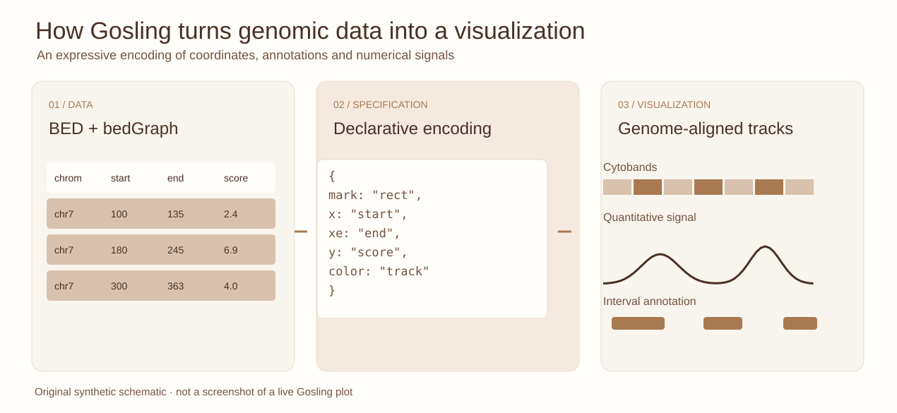
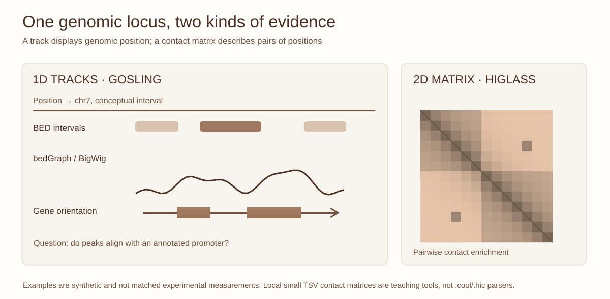

::: {.lesson-meta}
Computational + experimental90-minute interactive practicalBED · bedGraph · matrix TSV
:::

## Seeing alignment is not proving a biological mechanism

An accessible genomic element overlaps H3K27ac signal near a gene. A genome browser makes that alignment immediately visible. But visual concordance does not establish causality, cell-state specificity or enhancer targeting.

{fig-alt="Three-step Gosling teaching diagram: BED and bedGraph tables, conceptual declarative encoding and aligned synthetic genomic tracks."}

*Figure 1. Gosling's declarative principle: map coordinates and values to marks. The abbreviated specification is **illustrative pseudocode, not runnable JSON**; this is an original synthetic schematic, not an exported Gosling plot.*

[Open the full-resolution Gosling schematic ↗](../assets/gosling-workflow.svg){target="_blank"}

{fig-alt="Synthetic coordinate-aligned BED and quantitative signal tracks alongside a two-dimensional Hi-C contact matrix illustrating one-dimensional versus pairwise genomic observations."}

*Figure 2. Tracks have one genomic coordinate axis; Hi-C matrices compare pairs of genomic loci. The two visualizations answer different questions.*

## 1. Try the Genome Track Studio

This lesson provides a small **local browser-based visualization**, starting with invented BED peak intervals, bedGraph signal and a plain-text numeric contact matrix. You can load your own **small plain-text** files using the browser File API: these remain in your browser; they are not uploaded to a site or data server.

<iframe src="../interactives/genome-track-studio.html" title="Genome Track Studio for local BED bedGraph and matrix TSV data, plus optional public Gosling chart" class="learning-iframe learning-iframe--genome-studio" loading="lazy"></iframe>

*Interactive 1. The local BED/bedGraph and matrix plotter is original educational JavaScript, not an implementation of Gosling or HiGlass. The Gosling tab displays the **full-resolution offline SVG diagram**; the separately labelled live Gosling demonstration requires a network connection and may be blocked in restricted preview environments.*

**Four teaching experiments:** (1) Widen a BED peak; what changes in apparent overlap? (2) Alter bedGraph signal amplitude without changing interval calls; do the interpretations match? (3) Switch to a matrix; what is unknown without chromosome/bin metadata? (4) Open the Gosling tab and compare its labelled offline representation with the live public example when available. What changes when the categorical cytoband stain controls the colour encoding? If the live chart is blocked, use the linked official Gosling tutorial.

## 2. Learn what the files actually contain

| Extension | What is inside | Teaching or production viewer |
|---|---|---|
| BED | Plain-text genomic intervals, optional labels | This simple local demo; Gosling/browsers with appropriate format conversion or hosting |
| bedGraph | Plain-text quantitative intervals | Local demo; BigWig for large indexed genomic signals |
| BigWig / .bw | Indexed binary quantitative signal | Gosling or appropriate genome browser with accessible remote URL and CORS |
| BigBed / .bb | Indexed binary genomic annotations | A browser with bigBed support, not a BigWig signal reader |
| .hic / .cool / .mcool | Binary contact-matrix data | HiGlass or other compatible 2D browsers using appropriate tilesets |
| Matrix TSV | Small plain-text numeric NxN table | Local conceptual heatmap; not a full genome-assembly-aware contact viewer |

The original Gosling pilot treated a UCSC BigBed annotation as a BigWig signal. That format mismatch illustrates why file provenance and actual data semantics matter.

## 3. Where Gosling and HiGlass fit

**Gosling** provides a declarative JSON grammar for genomic tracks and interactive visualization. It can encode genomic position, quantitative value and categorical annotation. The official [Gosling tutorial](https://gosling-lang.org/tutorials/) provides a public cytoband example.

**HiGlass** is designed for large multi-resolution genomic tracks and chromosome contact maps, commonly using a compatible tile server for Cooler matrices and other genomic data. Its [official tutorial](https://docs.higlass.io/tutorial.html) documents ingestion and local viewing. Neither system should be advertised as accepting every unprocessed browser upload.

## 4. Bring your own files responsibly

For this zero-cost static educational site, small BED, bedGraph and TSV files are processed in-browser. Large indexed signal tracks or contact matrices require an appropriate dedicated viewing workflow. Host only data you are authorized to share; do not place private patient-derived or unpublished files on a public tile server.

**Student challenge:** Align a gene annotation, accessibility peaks, a quantitative signal and an appropriately documented contact matrix. For each layer specify genome build, coordinate convention, normalizations, provenance and one mechanistic conclusion that would remain unsupported. Save your visualization specification for reproducibility.

Continue with [ATAC-seq quality](atac-quality.qmd), [chromatin assay choice](chromatin-assays.qmd), [Hi-C structures](hic-structures.qmd) and [sample comparisons](comparing-hic-samples.qmd).

## References

- L'Yi S, Wang Q, Lekschas F, Gehlenborg N. Gosling: A Grammar-based Toolkit for Scalable and Interactive Genomics Data Visualization. *IEEE Transactions on Visualization and Computer Graphics* **28**, 140–150 (2022). [doi:10.1109/TVCG.2021.3114876](https://doi.org/10.1109/TVCG.2021.3114876).
- [Gosling official documentation and working examples](https://gosling-lang.org).
- Kerpedjiev P et al. HiGlass: web-based visual exploration and analysis of genome interaction maps. *Genome Biology* (2018). [doi:10.1186/s13059-018-1486-1](https://doi.org/10.1186/s13059-018-1486-1).
- [HiGlass data and view tutorial](https://docs.higlass.io/tutorial.html).
