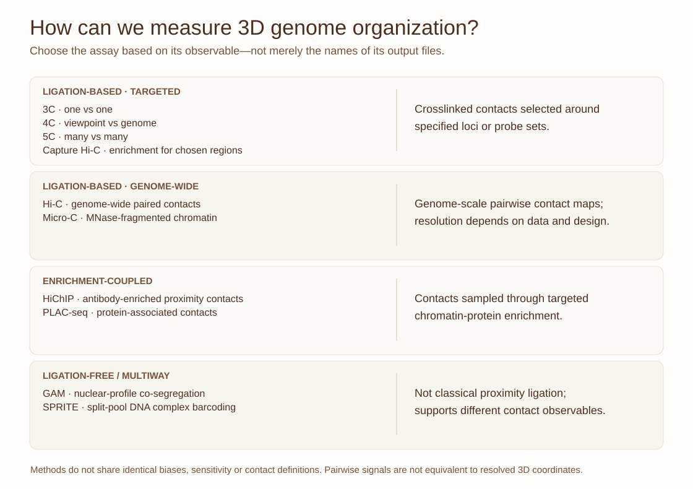

::: {.lesson-meta}
Experimental genomics60–80 minutesOriginal figureMethods selection
:::

## The method is part of the biological question

A tumour-derived organoid develops an altered transcriptional state. You want to know whether chromatin contacts at one candidate locus have changed, whether genome-wide folding is remodeled, or whether interactions are associated with a particular chromatin protein. These are related questions, but **they do not require identical measurements**.

{fig-alt="Four-category atlas grouping targeted 3C family, genome-wide Hi-C and Micro-C, enrichment-coupled HiChIP and PLAC-seq, and ligation-free GAM and SPRITE with their distinct observables."}

*Figure 1. Original, conceptual assay-family map. The methods differ in the physical quantity sampled, genomic scope, enrichment, resolution, input and biases. The categories simplify a rapidly developing field; consult original protocols when planning a real experiment.*

## What can each family measure?

| Family | Assays | Core observable | Main caution |
|---|---|---|---|
| Targeted 3C family | 3C, 4C, 5C | Contacts anchored at one or more selected regions | Viewpoints, design and restriction/ligation efficiency influence detection |
| Genome-wide ligation | Hi-C, Micro-C | Genome-wide proximity-ligation contacts | Contact frequency is not physical distance; depth and fragment processing matter |
| Protein-associated enrichment | HiChIP, PLAC-seq | Contacts enriched for chromatin associated with an antibody target | Enrichment biases affect the apparent landscape |
| Ligation-free approaches | GAM, SPRITE | Nuclear-profile co-segregation or barcoded multi-fragment complexes | The observable is not directly interchangeable with conventional Hi-C counts |

Micro-C uses micrococcal-nuclease fragmentation for nucleosome-scale chromatin conformation mapping; it is **not** a ligation-free technique. GAM infers chromatin association from nuclear slice co-segregation, while SPRITE uses split-pool barcoding to identify higher-order complexes. Neither directly solves a unique physical 3D reconstruction.

## Design studio: choose the assay, defend the claim

**Scenario A.** You have 20 organoid lines with paired RNA-seq and want genome-wide structural comparisons. Which approach gives appropriate genomic scope? How would you handle sequencing depth, copy-number changes and biological replication?

**Scenario B.** Your hypothesis specifically concerns an enhancer near a known cancer-associated gene. When might a capture-based strategy outperform untargeted genome-wide mapping? What becomes invisible when you enrich predefined viewpoints?

**Scenario C.** You suspect a chromatin regulator participates in a subset of contacts. What could an antibody-enriched contact assay establish, and what would you still need to test whether the regulator is *causal*?

**Scenario D.** The biology concerns multiway nuclear complexes or nuclear bodies. Why might SPRITE or GAM provide complementary information to proximity-ligation assays?

### Instructor prompt

Ask each student to specify the measurable outcome, a positive/negative control, a sample-level QC metric, one experimental bias and one inference that would remain unjustified.

## Connected 3D-genome lessons

- [Recognizing compartments, domains, loops and stripes](hic-structures.qmd)
- [Understanding bin width, read depth and O/E](hic-resolution-lab.qmd)
- [Comparing two or more Hi-C samples](comparing-hic-samples.qmd)
- [3D-genome terminology glossary](hic-glossary.qmd)

## References

- Tavallaee G, Orouji E. Mapping the 3D genome architecture. *Computational and Structural Biotechnology Journal* **27**, 89–101 (2025; available online 2024). [doi:10.1016/j.csbj.2024.12.018](https://doi.org/10.1016/j.csbj.2024.12.018).
- Lieberman-Aiden E et al. Comprehensive mapping of long-range interactions reveals folding principles of the human genome. *Science* (2009). [doi:10.1126/science.1181369](https://doi.org/10.1126/science.1181369).
- Mumbach MR et al. HiChIP: efficient and sensitive analysis of protein-directed genome architecture. *Nature Methods* (2016). [doi:10.1038/nmeth.3999](https://doi.org/10.1038/nmeth.3999).
- Beagrie RA et al. Complex multi-enhancer contacts captured by genome architecture mapping. *Nature* (2017). [doi:10.1038/nature21411](https://doi.org/10.1038/nature21411).
- Quinodoz SA et al. Higher-order inter-chromosomal hubs shape 3D genome organization in the nucleus. *Cell* (2018). [doi:10.1016/j.cell.2018.05.024](https://doi.org/10.1016/j.cell.2018.05.024).

*All artwork on this page was produced for teaching; no publisher figure has been reproduced.*
