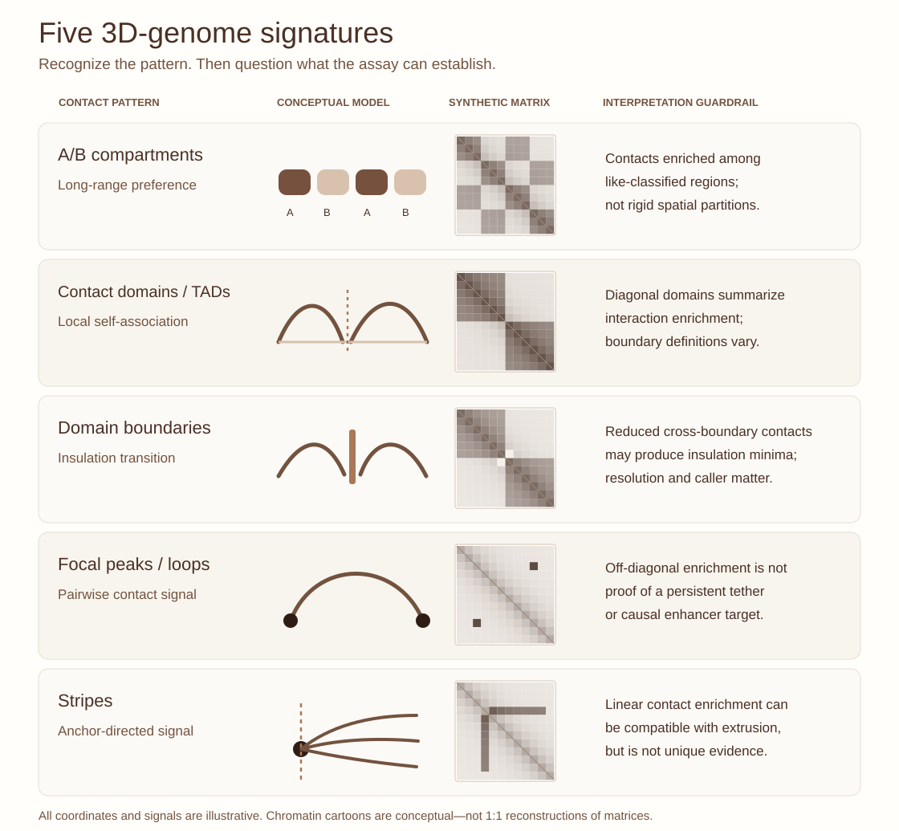
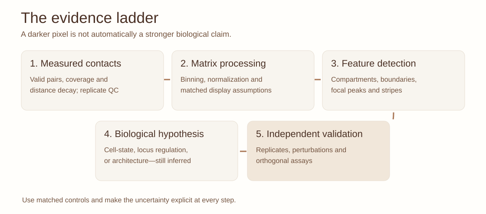

::: {.lesson-meta}
3D genomics70–90 minutesOriginal schematicFoundations → advanced
:::

## A contact map is a measurement, not a miniature chromosome

A Hi-C matrix is a population-level summary of proximity-ligation contacts. It can reveal highly reproducible patterns, but a feature in a matrix is **not** by itself a unique three-dimensional reconstruction, a stable molecular structure, or proof of gene regulation. The strongest interpretations connect quantitative signatures, experimental perturbations and independent assays.

{fig-alt="Five-row original schematic. Each row shows one idealized 3D-genome feature, a conceptual polymer depiction and an independently synthetic Hi-C pattern."}

*Figure 1. Original vector teaching atlas. Each matrix is a separate simplified pattern, not a measured locus or reconstruction. Larger labels and dedicated rows help distinguish features that overlap in real contact maps.*

{fig-alt="Five-step workflow showing how evidence moves from contact counts, through processing and feature inference, toward biological interpretation and orthogonal validation."}

*Figure 2. Contact-map interpretation workflow. The figure distinguishes observations from computational calls, models and functional proof.*

## 1. A/B compartments: segregation across long genomic distances

**What appears:** plaid/checkerboard enrichment, often clearest in distance-normalized or correlation-based representations, reflecting preferential contacts among regions with similar compartmental states. Compartment scores are commonly obtained from eigenvector-based analyses, but **the sign of an eigenvector is arbitrary** and must be oriented using external features such as GC content, chromatin accessibility or histone marks.

**What it suggests:** preferential association of active-like and inactive-like chromatin regions, not a binary label that every single cell must obey. The classical A/B terminology is an operational genomic classification, not a direct visualization of nuclear position.

**Question:** Could a change in compartment score reflect cell-composition differences rather than a state transition within the same cell type?

## 2. TADs and contact domains: enriched local contacts

**What appears:** a block or square of elevated contacts along the matrix diagonal. Boundaries can be estimated using insulation, directionality, or other segmentation strategies; different callers and resolutions may disagree.

**What it suggests:** increased contact frequency within a genomic interval relative to neighbouring intervals. A contact domain is a **statistical property of the measured matrix**, not necessarily a physically insulated, permanently closed chromatin loop. Domain architecture can be heterogeneous and dynamic across cells.

**Question:** How would you demonstrate that a boundary change is reproducible after matching read depth and bin size?

## 3. Focal peaks and loops: enrichment is not permanence

**What appears:** a punctate off-diagonal contact enrichment, frequently near the corner of a domain in high-resolution maps.

**What it suggests:** increased proximity-ligation frequency between two genomic loci relative to an appropriate local or distance-matched background. Some focal enrichments are associated with CTCF/cohesin architecture, but a peak is not automatically a stable loop or enhancer–promoter interaction.

**Question:** Which independent evidence would establish a functional enhancer target rather than a contact association?

## 4. Stripes: directional enrichment from an anchor

**What appears:** a linear enrichment extending horizontally or vertically from a locus across multiple genomic positions, often discussed in relation to loop extrusion and barriers.

**What it suggests:** a contact-enrichment pattern consistent with particular mechanistic models. **A stripe alone does not uniquely prove ongoing extrusion**; alternative mechanisms and experimental biases must be considered.

**Question:** What would happen to a stripe under cohesin depletion, and why would you still need matched controls?

## 5. Loop extrusion, CTCF and cohesin

In an influential model, cohesin can progressively enlarge chromatin loops until constrained by barriers such as suitably oriented CTCF sites. Perturbations of cohesin and CTCF support important aspects of this framework. However, not all contact domains or compartment patterns depend on the same machinery; compartmental segregation and extrusion-associated patterns can coexist. The dynamic nature of the process also matters: population Hi-C maps average over many configurations.

## 6. From structure to cancer biology

A CRC organoid might show a shifted contact-domain boundary, an altered enhancer-associated focal enrichment, and a transcriptional change. That combination motivates a mechanistic hypothesis but does not prove that the boundary caused the transcriptional effect. A strong study would check replicate concordance, cell-state composition, structural variants, local copy number, mapping bias, orthogonal chromatin evidence, and targeted perturbation.

For a practical exercise in binning and depth, continue to [What survives when you change Hi-C resolution?](hic-resolution-lab.qmd). For cross-sample inference, continue to [What changes between Hi-C samples?](comparing-hic-samples.qmd).

## Interactive identification: what pattern do you see?

Can you tell a domain boundary from a stripe? Can you identify an off-diagonal focal peak without implying a permanent physical tether? Select each of five **independent conceptual matrices**, choose the most likely feature, and reveal its interpretation caveat.

<iframe src="../interactives/hic-feature-lab.html" title="Interactive Hi-C feature recognition with five synthetic matrices" class="learning-iframe learning-iframe--structures" loading="lazy"></iframe>

*Interactive 1. Original synthetic lesson activity. The diagrams are deliberately isolated signatures; a real Hi-C map can contain several patterns simultaneously. For definitions, see the [3D-genome glossary](hic-glossary.qmd).*

For experimental context, explore [which chromatin architecture assay to choose](hic-assays.qmd). The [Hi-C resolution laboratory](hic-resolution-lab.qmd) then explores why bin width, sampling depth and O/E transformations change how the patterns appear.

## Student exercise: annotate without overclaiming

Sketch a 10 × 10 contact matrix with (i) a checkerboard pattern, (ii) two diagonal squares, (iii) one focal off-diagonal enrichment, and (iv) one stripe. For each, provide a **pattern label**, a **plausible mechanism**, and **one alternative explanation or limitation**. Do not infer a causal gene-regulatory effect without functional evidence.

## References

- Tavallaee G, Orouji E. Mapping the 3D genome architecture. *Computational and Structural Biotechnology Journal* **27**, 89–101 (2025; online 2024). [doi:10.1016/j.csbj.2024.12.018](https://doi.org/10.1016/j.csbj.2024.12.018).
- Lieberman-Aiden E et al. Comprehensive mapping of long-range interactions reveals folding principles of the human genome. *Science* (2009). [doi:10.1126/science.1181369](https://doi.org/10.1126/science.1181369).
- Dixon JR et al. Topological domains in mammalian genomes identified by analysis of chromatin interactions. *Nature* (2012). [doi:10.1038/nature11082](https://doi.org/10.1038/nature11082).
- Rao SSP et al. A 3D map of the human genome at kilobase resolution reveals principles of chromatin looping. *Cell* (2014). [doi:10.1016/j.cell.2014.11.021](https://doi.org/10.1016/j.cell.2014.11.021).
- Fudenberg G et al. Formation of chromosomal domains by loop extrusion. *Cell Reports* (2016). [doi:10.1016/j.celrep.2016.04.085](https://doi.org/10.1016/j.celrep.2016.04.085).
- Rowley MJ, Corces VG. Organizational principles of 3D genome architecture. *Nature Reviews Genetics* (2018). [doi:10.1038/s41576-018-0060-8](https://doi.org/10.1038/s41576-018-0060-8).
