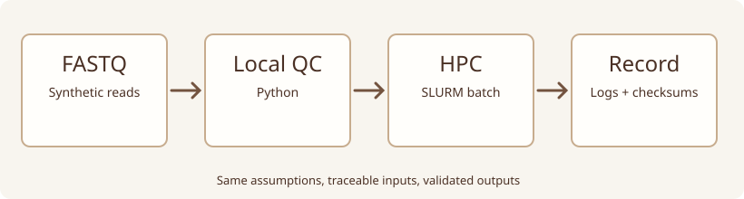

::: {.lesson-meta}
<span class="pill">Foundations → Intermediate</span><span class="pill">75–100 minutes</span><span class="pill">Python · Bash · SLURM</span><span class="pill">Synthetic FASTQ</span>
:::

## Start with an uncomfortable question

A pipeline runs on a laptop and then on an HPC cluster, but the outputs differ. Did the *biology* change? Almost certainly not. The more plausible explanations include different inputs, tool versions, reference assemblies, defaults or random seeds. The useful question is not only **how to run the command**, but **what makes the result independently reproducible**.

By the end you should be able to read a FASTQ record, compute simple raw-read QC, distinguish a login node from a scheduled job, and describe a minimal record of computational provenance.

## 1. From instrument to interpretation

{fig-alt="Conceptual path from reads to local QC, HPC processing and documented outputs; original, not experimental data."}

FASTQ encodes sequence and a quality string. For Phred-scaled qualities, the conventional probability model is \(P(\mathrm{error})=10^{-Q/10}\). This *base-calling* uncertainty does not validate the assay. In ATAC-seq, fragment length distributions, signal around transcription start sites, enrichment and reproducibility remain essential.

| Object | What can go wrong | What to document |
|---|---|---|
| Input reads | Accidental sample swap | De-identified ID, checksum, source |
| Reference | Mixed genome builds | Assembly and annotation release |
| Method | Silent parameter change | Tool versions, flags, configuration |
| Environment | Missing dependencies | Software/environment lockfile |
| Output | Result cannot be recreated | Logs, checksums, script commit |

## 2. Practical: examine four invented reads

[Download synthetic FASTQ](../exercises/local-to-hpc/toy_reads.fastq) and [Python QC script](../exercises/local-to-hpc/fastq_summary.py), then run from the repository root:

```bash
python3 exercises/local-to-hpc/fastq_summary.py \
  exercises/local-to-hpc/toy_reads.fastq
```

The output reports read count, mean read length, GC fraction, ambiguous-base fraction and mean Phred+33 quality. The parser rejects incomplete records or discordant sequence/quality lengths. It is **not** a replacement for FastQC or MultiQC.

**Counterexample:** change a base to `N` in a copy of the FASTQ. Read count remains unchanged, while the ambiguity metric changes. Now lower one quality character. Why is neither observation a sufficient statement about downstream biological reliability?

## 3. Practical: the same logic on a cluster

SLURM schedules compute jobs instead of allowing users to run heavy tasks indefinitely on shared login nodes. Download the [sample batch script](../exercises/local-to-hpc/run_qc.slurm); review it before submitting:

```bash
sbatch exercises/local-to-hpc/run_qc.slurm
squeue -u "$USER"
```

The example assumes Python is available and that your cluster accepts the configured job parameters. Your HPC may require site-specific `--account`, `--partition` or environment modules. **Do not submit the template without checking local policy.**

## 4. Reproducibility challenge

Three colleagues report identical raw-read counts, yet use hg19, GRCh38 and a mouse reference respectively. Which outputs can be directly compared? Design a minimal `run_metadata.txt` containing input checksum, reference assembly, annotation release, executable versions, arguments, environment, date and Git commit. Explain which fields prevent the error.

### Assessment

1. Why is raw-read QC not equivalent to assay-specific QC?
2. What difference does a batch scheduler make to resource use and provenance?
3. Can a successful exit code mean scientifically valid output if the wrong FASTQ was processed?
4. How would you scale this to multiple samples without editing filenames in a Python script?

## References

- Cock PJA et al. *The Sanger FASTQ file format for sequences with quality scores*. Nucleic Acids Research (2010). [doi:10.1093/nar/gkp1137](https://doi.org/10.1093/nar/gkp1137).
- Corces MR et al. *An improved ATAC-seq protocol reduces background and enables interrogation of frozen tissues*. Nature Methods (2017). [doi:10.1038/nmeth.4396](https://doi.org/10.1038/nmeth.4396).
- SLURM official [sbatch](https://slurm.schedmd.com/sbatch.html) documentation.

*Original conceptual illustration and wholly synthetic reads. No patient data.*
