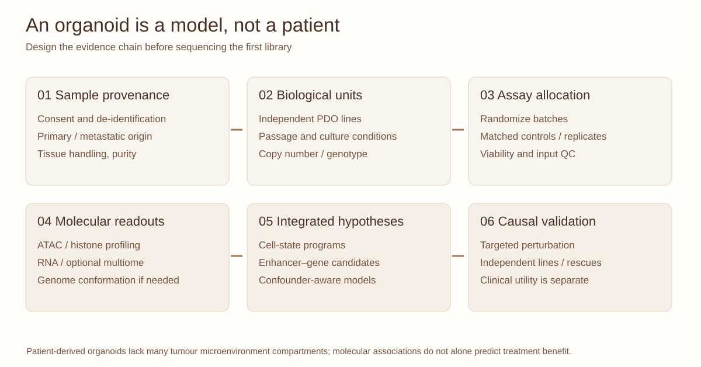

::: {.lesson-meta}
Organoid genomicsAdvanced90-minute seminarHypothetical case study
:::

## The strongest dataset is not necessarily the strongest experimental design

Suppose four colorectal cancer patient-derived organoid (PDO) lines are profiled using RNA-seq, ATAC-seq and histone-mark assays, with a subset analyzed by single-cell multiome. Do the individual cells automatically give you thousands of independent experimental replicates? **No.** The independent biological unit, donor and cell-state mixture define what you can claim.

{fig-alt="Six-step workflow from patient sample provenance and independent organoid lines through assay allocation, molecular profiling, integrated hypotheses and causal validation."}

*Figure 1. Original vector schematic. The case is fictional and contains no unpublished results or patient measurements.*

## 1. Choose the biological unit

Cells nested within an organoid line are **not interchangeable with independent organoid lines**, and multiple aliquots from a single culture may be technical or limited biological replicates. Define donor, line, passage, treatment, batch and replicate structure before analysis. Match controls for the actual scientific question, which could be paired normal epithelium, untreated cultures or an independent disease-relevant cell state.

## 2. A multi-omics evidence ladder

| Layer | Useful measurement | Main inference limit |
|---|---|---|
| ATAC-seq | Accessible DNA | Not necessarily enhancer activity |
| Histone profiling | Target-associated chromatin signal | Does not uniquely assign a gene |
| RNA-seq | Abundance and transcriptional programs | Cell-state and composition may confound |
| Hi-C or Micro-C | Contact architecture | Association is not regulatory causality |
| CRISPRi / deletion | Perturbation of a candidate element | Off-target and cell-state-specific effects |
| Drug screens | Model response under tested conditions | Not independently predictive of patient benefit |

## 3. Scientific case: neuroendocrine-like programs

A hypothetical CRC PDO subpopulation shows increased neuroendocrine-associated transcription, accessibility near developmental regulators and candidate distal elements. Which observations indicate a *cell state*, and which would justify a *causal regulatory program*? How might normal enteroendocrine contamination or lineage composition mimic the finding?

Ask students to propose marker-based malignant-cell filtering, copy-number-aware checks, replicate-level validation and perturbation experiments. This question is inspired by broad cancer plasticity biology, not the findings of any unpublished OroujiLab manuscript.

## 4. The faculty-style teaching exercise

Give each group a limited budget and three possible assay combinations. Require them to deliver:

1. A precise biological hypothesis and primary endpoint.
2. Biological-unit and batch structure.
3. A QC plan for each measurement.
4. One alternative explanation for the anticipated result.
5. A validation plan and the limits of clinical translation.

Cross-reference [ATAC-seq quality](atac-quality.qmd), [chromatin profiling choices](chromatin-assays.qmd), [enhancer causality](enhancer-to-organoid.qmd), and [biomarker interpretation](biomarker-evidence.qmd).

## References

- van de Wetering M et al. Prospective derivation of a living organoid biobank of colorectal cancer patients. *Cell* (2015). [doi:10.1016/j.cell.2015.03.053](https://doi.org/10.1016/j.cell.2015.03.053).
- Fujii M et al. A colorectal tumor organoid library demonstrates progressive loss of niche factor requirements during tumorigenesis. *Cell Stem Cell* (2016). [doi:10.1016/j.stem.2016.04.003](https://doi.org/10.1016/j.stem.2016.04.003).
- Fulco CP et al. Activity-by-contact model of enhancer–promoter regulation from thousands of CRISPR perturbations. *Nature Genetics* (2019). [doi:10.1038/s41588-019-0538-0](https://doi.org/10.1038/s41588-019-0538-0).
